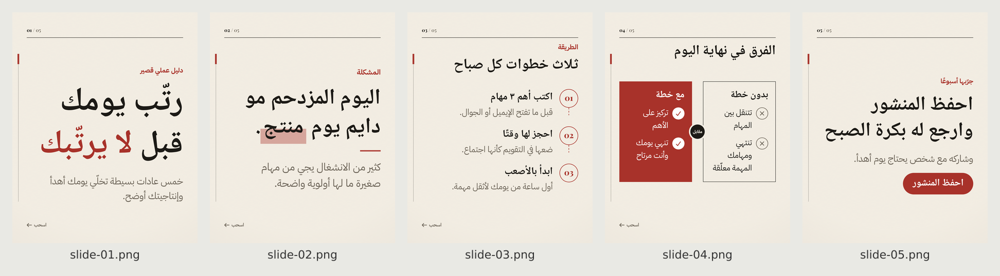

# سياق كاروسيل | Siyaq Carousel

مهارة (Skill) لـ Claude Code وCodex تصمم كاروسيلات عربية للسوشال ميديا وتسلّمها **ملفات صور حقيقية**:
تبحث عند الحاجة، تكتب المحتوى، تختار الإخراج الفني، ترسم الشرائح بالمقاس الدقيق، تفحص الجودة، ثم تسلّم
`slide-01.png…` وملف ZIP للصور وملفات HTML/CSS قابلة للتعديل. مصادر البحث تبقى سجلًا داخليًا وتُسلَّم فقط إذا طلبتها.

مبنية على فكرة [Open Carrusel](https://github.com/Hainrixz/open-carrusel) (تركيب الشرائح بـ HTML/CSS ثم تصويرها بمتصفح)
بعد تحويلها من تطبيق ويب إلى مهارة محمولة بأداة سطر أوامر مستقلة. التفاصيل في [NOTICE.md](NOTICE.md).



## وش تسوي المهارة

- **مدخلات:** موضوع أو نص جاهز، المنصة أو مقاس مخصص، استايل أو صورة مرجعية، وبشكل اختياري: الهوية (شعار، ألوان، خطوط)،
  صور منتجات، أسعار وعروض، حسابات وتواصل، CTA، عدد الشرائح، طلب معاينة.
- **كل كاروسيل يبدأ بخطّاف قوي:** عنوان قصير وبارز في الشريحة الأولى مبني على الموضوع والجمهور والهدف (فائدة أو ألم للمنتجات، مشكلة أو سؤال أو معلومة للمحتوى التعليمي). المهارة تكتب ثلاثة بدائل داخليًا وتختار الأقوى بدون ما تسألك، إلا إذا طلبت معاينة، وتفحص آليًا أنه ليس عامًا مثل «مقدمة عن…» وأنه أكبر نص في الغلاف.
- **العدد الافتراضي ٥ شرائح**، ويمكن أي عدد (اختُبر ١٢)، مع تقسيم ZIP على دفعات إذا تجاوز حد المنصة.
- **17 نمطًا** بمواصفات كاملة + **17 سمة** قابلة للدمج + أنماط مخصصة محفوظة + تحليل صورة مرجعية.
- **13 قالبًا** حسب المحتوى: غلاف، عبارة، قائمة، خطوات، مقارنة، أرقام، اقتباس، منتج، دعوة، صورة، خط زمني، مخطط، HTML حر.
- **استمرارية بصرية** عبر الشرائح (شريط، مسار بمحطات، أشكال على الحدود، مشهد يتكشف، عنصر يتطور، بانوراما) بتطابق بكسلي.
- **عربية سليمة:** RTL، خطوط عربية محلية (26 عائلة OFL)، عزل تلقائي للروابط والحسابات والأرقام والنطاقات، أرقام عربية أو لاتينية.
- **أيقونات منصات** مرخّصة (Instagram, TikTok, Snapchat, X, Facebook, YouTube, LinkedIn, WhatsApp, Telegram, Pinterest, Threads, البريد…)
  تظهر فقط للحسابات المعطاة، و**QR** فقط لرابط حقيقي وبحجم قابل للمسح.
- **فحص جودة آلي** بعد كل رسم + فحص بصري إلزامي من المساعد قبل التسليم.

## التثبيت

المتطلبات: **Node.js 20 أو أحدث**، ونحو 400MB لمتصفح Chromium الخاص بـ Playwright. لا يلزم Python ولا أي مفتاح API.

### Claude Code

```bash
mkdir -p ~/.claude/skills
unzip siyaq-carousel.zip -d ~/.claude/skills/          # ينتج ~/.claude/skills/siyaq-carousel/
cd ~/.claude/skills/siyaq-carousel
npm install
npx playwright install chromium                          # مرة واحدة إذا ما عندك المتصفح
node scripts/siyaq.mjs doctor                            # كل البنود يجب أن تكون ✅
```

للتثبيت داخل مشروع واحد بدل كل المشاريع: استخدم `.claude/skills/siyaq-carousel/` في جذر المشروع.

### Codex

```bash
mkdir -p ~/.agents/skills
unzip siyaq-carousel.zip -d ~/.agents/skills/            # ينتج ~/.agents/skills/siyaq-carousel/
cd ~/.agents/skills/siyaq-carousel
npm install && npx playwright install chromium && node scripts/siyaq.mjs doctor
```

أو داخل مستودع: `.agents/skills/siyaq-carousel/`. الملف `agents/openai.yaml` اختياري لاسم العرض في واجهة Codex.

> **حالة التوافق:** Claude Code ✅ مُختبر فعليًا (Claude Code 2.1.288، وضع `claude -p`).
> Codex ⚠️ **غير متحقق** لأنه غير متاح في بيئة البناء — خطوات التحقق الدقيقة في [references/runtimes.md](references/runtimes.md).
> أداة الرسم نفسها لا تعتمد على أي منهما، فتعمل من أي طرفية.

## طريقة الاستدعاء

اكتب في المحادثة أيًا من:

- `سياق كاروسيل` ← تظهر رسالة الترحيب.
- `استخدم سياق كاروسيل: كاروسيل إنستقرام عن ٥ أخطاء في إدارة الميزانية الشخصية، للشباب، ستايل infographic`
- `صمم باستخدام سياق كاروسيل: ٧ شرائح تيك توك لمنتجنا (الصور مرفقة)، الهوية: أخضر #1F4D3A وذهبي #C8963E، الشعار مرفق، الحساب @brand`
- `سياق كاروسيل — أبي معاينة الغلاف أول قبل باقي الشرائح`
- في Claude Code أيضًا: `/siyaq-carousel` · في Codex: `$siyaq-carousel`.

إذا كان الموجز كاملًا تبدأ المهارة مباشرة. السؤال الوحيد الممكن عند النقص: المنصة أو المقاس.

## خيارات الإدخال

| الخيار | القيم |
|---|---|
| المنصة | `instagram-portrait` 1080×1350 · `instagram-square` 1080×1080 · `tiktok-photo` 1080×1920 · `stories` 1080×1920 · `facebook-portrait` · `linkedin-portrait` · `threads` · `x-landscape` 1600×900 · `pinterest` 1000×1500 · مقاس مخصص 320–4096 بكسل |
| الاستايل | editorial, minimal, swiss, bold, product, luxury, collage, playful, comic, retro, infographic, tech, gradient, glass, geometric, sketch, photo — أو وصف حر يتحول لنمط مخصص يُحفظ ويُعاد استخدامه |
| الهوية | شعار (PNG/SVG)، ألوان HEX، خطوط TTF/OTF/WOFF/WOFF2، اسم العلامة، الحسابات، التواصل |
| الصور | PNG/JPEG/WebP/GIF/AVIF/SVG — تُستخدم كما هي بدون تعديل |
| المحتوى | موضوع للبحث والكتابة، أو نص جاهز (ويمكن قفله حرفيًا `exact`) |
| CTA | اطلب الآن · تواصل معنا · اكتشف المزيد · احفظ المنشور · شاركها مع غيرك · تابعنا — مع QR اختياري لرابط حقيقي |
| الاستمرارية | ribbon · path · shape · scene · motif · panorama |
| سير العمل | تسليم مباشر (افتراضي) أو معاينة (محتوى / غلاف / اتجاه تصميم / كامل) |

صيغة الملف الكاملة: [references/spec.md](references/spec.md) · الأنماط: [references/styles.md](references/styles.md).

## أداة الرسم (تعمل بدون أي مساعد)

```bash
node scripts/siyaq.mjs init ./work                                  # ينشئ ./work/carousel.json مثال
node scripts/siyaq.mjs render ./work/carousel.json --out ./work/out # رسم وتصدير كامل
node scripts/siyaq.mjs render ./work/carousel.json --out ./work/out --slides 3      # تعديل شريحة واحدة
node scripts/siyaq.mjs render ./work/carousel.json --out ./work/out --preview --slides 1  # معاينة الغلاف
node scripts/siyaq.mjs sources ./work/out                           # تصدير المصادر (فقط إذا طلبها المستخدم)
node scripts/siyaq.mjs validate ./work/carousel.json                # فحص بدون رسم
node scripts/siyaq.mjs verify ./work/out                            # مطابقة المصدر القابل للتعديل مع الصور
node scripts/siyaq.mjs analyze-ref reference.jpg                    # تحليل صورة مرجعية
node scripts/siyaq.mjs font-check MyFont.ttf --text "نص تجريبي"      # فحص خط
node scripts/siyaq.mjs save-style my-style.json                     # حفظ نمط مخصص
node scripts/siyaq.mjs list styles|traits|platforms|layouts|fonts|icons|continuity
node scripts/siyaq.mjs welcome | doctor
```

جرّب المثال الجاهز: `node scripts/siyaq.mjs render examples/basic-ar/carousel.json --out /tmp/siyaq-demo`

## المخرجات

| الملف | الوصف |
|---|---|
| `slide-01.png` … | الشرائح بالمقاس المطلوب بالضبط |
| `<slug>-slides.zip` | صور الشرائح فقط (PNG)، و`-partN.zip` إذا تجاوز العدد حد المنصة (صور فقط أيضًا) |
| `<slug>-source.zip` و`source/` | HTML/CSS قابل للتعديل لكل شريحة + الخطوط المضمنة + الصور + التراخيص |
| `_internal/sources.md` | **سجل داخلي** للمصادر بالعربية (العنوان، الرابط، تاريخ الوصول، الادعاء والشريحة، حدود اليقين). لا يُضمَّن في أي ZIP ولا يُرفق مع الصور؛ يُصدَّر فقط عند طلبك: `node scripts/siyaq.mjs sources OUT` |
| `contact-sheet.png` / `continuity-strip.png` | لوحة مراجعة لكل الشرائح / الشريط المتصل |
| `qc-report.md` / `.json` | نتيجة فحص الجودة |
| `versions/slide-XX/` | النسخ السابقة عند تعديل شريحة |

لا يُنشأ ZIP إذا فشل فحص الجودة. لا علامات مائية ولا نص «سياق كاروسيل» داخل التصاميم.

## البحث والمصادر

عندما يحتاج الموضوع معلومات واقعية تبحث المهارة في مصادر رسمية وموثوقة وتتحقق من التواريخ، ولا تخترع أرقامًا أو دراسات أو
اقتباسات. المصادر تُسجَّل داخليًا في `_internal/sources.md` للمراجعة والتحقق، لكنها **لا تُرفق مع الصور** ولا تدخل في أي ZIP.
إذا تبي المصادر اطلبها («أبي المصادر») وتُسلَّم لك كملف مستقل.

## الاعتماديات

`playwright` (Chromium للرسم) · `sharp` (فحص الصور وPNG) · `fontkit` (فحص الخطوط والحروف) · `qrcode` · `yazl` (ZIP).
كلها مفتوحة المصدر وتعمل محليًا. الخطوط OFL، والأيقونات Font Awesome Free (CC BY 4.0).

## اختبارات القبول

```bash
npm test                       # = node tests/run-acceptance.mjs (المخرجات في ./test-output)
```

تشغّل الاختبارات A–M فعليًا (رسم، ثم فحص الملفات الناتجة) وتكتب `test-output/test-report.md`.
آخر تشغيل: **15 من 15 ناجحة** (A–M + اختبار N للخطّاف) — التقرير مرفق في `tests/report/test-report.md`.

## القيود الفعلية

- **مقاسات المنصات:** صفحات المساعدة الرسمية لا تؤكد إلا جزءًا منها (إنستقرام: عرض حتى 1080px). باقي المقاسات وحدود عدد
  الشرائح والمناطق الآمنة إرشادات شائعة، موسومة في `registry/platforms.json` وقابلة للتعديل.
- **لا توليد صور بالذكاء الاصطناعي** داخل المهارة، ولا صور فوتوغرافية أو ثلاثية الأبعاد من العدم. التصميم يعتمد على
  الطباعة والأشكال والأيقونات وصور المستخدم.
- **الصور منخفضة الدقة** تُعرض بأفضل ما يمكن مع تنبيه، ولا يمكن تحسين دقتها.
- **رمز الريال السعودي الجديد** غير موجود في الخطوط المضمنة؛ يُكتب «ر.س».
- **الإيموجي** يُرسم بخط النظام ويختلف شكله بين الأجهزة (QC ينبّه).
- **كاروسيل PDF في لينكدإن** غير مدعوم؛ التصدير PNG فقط.
- **فحص التباين** يقيس البكسلات تحت النص وهو تقديري؛ الفحص البصري لا يُستغنى عنه.
- **Codex** غير متحقق منه عمليًا بعد (انظر أعلاه).
- رسم Chromium قد يختلف اختلافًا طفيفًا جدًا بين أنظمة التشغيل (تنعيم الحواف)؛ `verify` يقيس ذلك.

## حل المشاكل

| المشكلة | الحل |
|---|---|
| `doctor` يقول المتصفح غير موجود | `npx playwright install chromium`، أو حدد متصفحًا موجودًا: `SIYAQ_CHROME_PATH=/path/to/chrome` |
| خطأ مكتبات نظام عند تشغيل Chromium على لينكس | `npx playwright install-deps chromium` |
| `USER_FONT_MISSING_GLYPHS` | خطك لا يحتوي بعض الحروف المستخدمة؛ غيّر الخط أو النص، أو اسمح بالبديل لهذه الحروف `allowFallback: true` |
| `FONT_INVALID` | الملف ليس خطًا صالحًا أو تالف؛ أعد تصديره TTF/OTF |
| `TEXT_OVERFLOW` | النص أطول من الشريحة؛ اختصره أو قسّمه على شريحتين |
| `EXACT_TEXT_CONFLICT` | نص حرفي لا يتسع؛ قرارك: تقسيم أو اختصار |
| `OUTSIDE_SAFE_AREA` | عنصر مهم في منطقة واجهة المنصة؛ قلل النص أو غيّر القالب |
| `LOW_CONTRAST` | غيّر لوحة الألوان أو موضع النص فوق الصورة |
| `IMAGE_UPSCALED` | الصورة أصغر من مساحتها؛ أرسل نسخة أعلى دقة أو استخدم قالبًا يعرضها أصغر |
| `ASSET_UNREADABLE` (HEIC/TIFF) | حوّل الصورة إلى JPG أو PNG |
| `CANVAS_INVALID` | المقاس خارج 320–4096 أو النسبة أكبر من 4:1 |
| الخطوط المرفوعة غير موجودة في حزمة المصدر | مقصود (ترخيص غير معروف)؛ أضف `redistributable: true` إذا كان ترخيصها يسمح |

## التحقق من التثبيت

1. `node scripts/siyaq.mjs doctor` ← كل البنود ✅.
2. `node scripts/siyaq.mjs render examples/basic-ar/carousel.json --out /tmp/siyaq-demo` ← «أخطاء 0» و5 صور 1080×1350 وZIP.
3. افتح `/tmp/siyaq-demo/contact-sheet.png` وتأكد أن العربي متصل وواضح.
4. `npm test` ← «15/15».
5. في Claude Code أو Codex اكتب «سياق كاروسيل» ← رسالة الترحيب وآخر سطر «سياق كاروسيل إحدى منتجات نطاق».

## الترخيص

MIT — انظر [LICENSE](LICENSE) و[NOTICE.md](NOTICE.md) (نسب Open Carrusel، تراخيص الخطوط والأيقونات).

سياق كاروسيل إحدى منتجات نطاق
